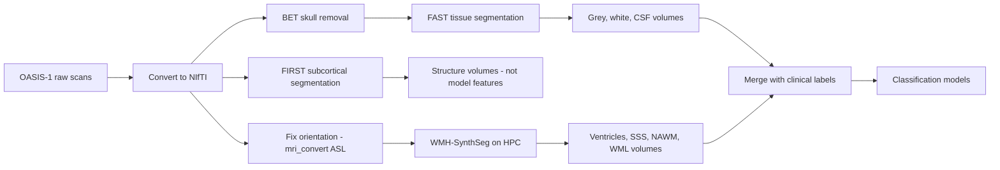

# Dementia Prediction from Brain Atrophy and White Matter Hyperintensities (OASIS-1)

A machine learning pipeline that classifies subjects as **no dementia (CDR 0)** or **dementia (CDR 1+)** from structural MRI. Atrophy and white matter hyperintensity (WMH) measures are extracted from T1-weighted scans with FSL and FreeSurfer, then combined with clinical variables for classification. The feature set follows Aribisala et al. (2013), who studied brain atrophy and white matter lesions together.

Built during industrial training (SIWES) at DATICAN.

## Why these features

- **Atrophy:** As the brain shrinks, tissue volume falls and fluid spaces (CSF, ventricles) grow.
- **WMH:** Bright lesions in white matter linked to vascular damage, a different pathway from atrophy, so combining both may predict better than either alone.
- OASIS-1 has **T1 scans only** (no FLAIR/T2), so WMH is *estimated* with WMH-SynthSeg, which works directly from T1.

## Pipeline

## Methods

**1. Tissue segmentation (FSL).** `bet` removes the skull; `fast` gives a probability map per tissue (`pve_0` CSF, `pve_1` grey, `pve_2` white). Each map is thresholded at 0.5 and the voxels counted with `fslstats -V`. Volume = voxel count x voxel size (1 x 1 x 1.25 mm). See `scripts/process_subject.sh` and `scripts/tissue_extraction.sh`.

**2. Subcortical segmentation (FSL FIRST).** 15 structures (thalamus, caudate, putamen, pallidum, hippocampus, amygdala, accumbens, brainstem), run on the whole-head T1 and not the BET output. Completed as a segmentation deliverable; these volumes are not model features, and the scripts are not included in this repository.

**3. WMH on an HPC (FreeSurfer 8.1.0, SLURM).** OASIS raw files carry no orientation information (the scans are sagittal, 1 x 1 x 1.25 mm), so a first test gave impossible volumes. Fix: `mri_convert --in_orientation ASL`, then `mri_WMHsynthseg` on all 436 scans (`scripts/run_wmh.sh`). After the fix the hemispheres were symmetric, ICV agreed with the OASIS eTIV, and WMH and ventricular volume rose with age and CDR.

**4. Features** (full list in `docs/data_dictionary.md`).

| Feature | Source |
|---|---|
| Grey matter, white matter, CSF, TBV (grey + white) | FSL FAST |
| Ventricular volume (lateral + 3rd + 4th) | WMH-SynthSeg |
| SSS (extracerebral CSF) | WMH-SynthSeg |
| NAWM (left + right white matter) | WMH-SynthSeg |
| WML volume (label 77) | WMH-SynthSeg |
| eTIV, nWBV, ASF, age, sex, education, SES, MMSE | OASIS-1 clinical table |

**5. Modelling** (`notebooks/`). Binary target (CDR 0 vs 1; CDR 2 merged into 1, CDR 0.5 removed). 366 subjects remain after data curation, which reduces down to a finalized modeling cohort of 159 rows after dropping missing entries across clinical indicators and Socioeconomic Status (`SES`) matrices. Stratified 70/30 split: 111 train, 48 test (40 vs 8). `StandardScaler` fitted on train only; `scale_pos_weight` is applied to balance the tree boosting matrix partitions. Models: Random Forest, XGBoost, linear SVC, Logistic Regression.

## Results

Held-out test set of 48 subjects, **only 8 with dementia**. Precision, recall and F1 are for the dementia class (Class 1).

| Model | Accuracy | Precision | Recall | F1 | AUC |
|---|---|---|---|---|---|
| **XGBoost Classifier** | **0.96** | **0.88** | **0.88** | **0.88** | **0.963** |
| Random Forest | 0.94 | 0.86 | 0.75 | 0.80 | 0.963 |
| Logistic Regression | 0.96 | 1.00 | 0.75 | 0.86 | 0.981 |
| Linear SVC | 0.92 | 1.00 | 0.50 | 0.67 | 0.959 |

Top XGBoost feature importances extracted via tree weights: MMSE (0.2615), nWBV (0.2191), SSS (0.0847), Ventricular_vol (0.0755), and NAWM (0.0660).

## Figures

## Repository structure

